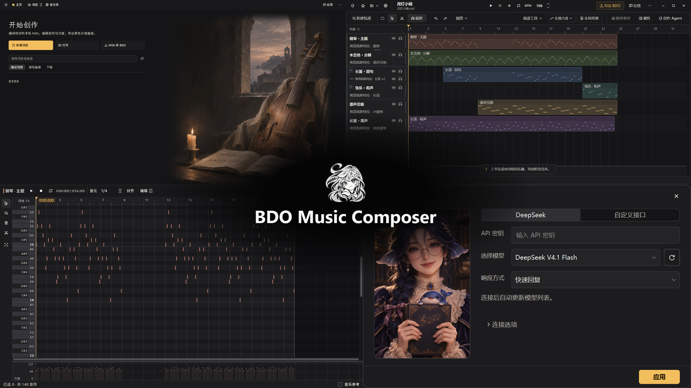
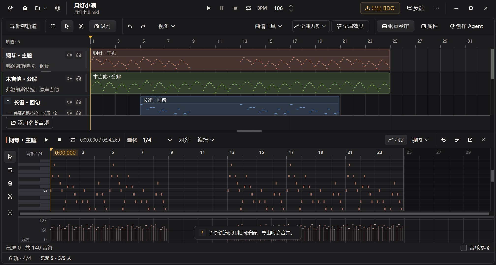

  

  <a href="docs/locales/zh-CN.md">简体中文</a> ·
  <a href="docs/locales/en.md">English</a> ·
  <a href="docs/locales/ja.md">日本語</a> ·
  <a href="docs/locales/ko.md">한국어</a>

  <strong>A Windows multitrack editor for Black Desert composers</strong> 
  MIDI import · Clip arrangement · Piano roll · BDO v9 export

  <a href="https://github.com/CocoaMist/BDO_Music_Composer/releases"><strong>Download for Windows</strong></a> ·
  <a href="https://github.com/CocoaMist/BDO_Music_Composer/issues">Report an issue</a> ·
  <a href="CHANGELOG.md#unreleased">Changelog</a>

  <a href="#why-i-built-it">Why I built it</a> ·
  <a href="#what-you-can-do">What you can do</a> ·
  <a href="#getting-started">Getting started</a> ·
  <a href="#source-and-license">Source and license</a>

---

## Why I built it

I built this tool so Black Desert players can arrange music, listen to it locally, and bring their scores back into the game to play together. If you have a MIDI file and want the flute to come in on the second pass, or want a few notes in the accompaniment to play more softly, you can make those edits in the project. Playback, saving, and export all use the notes you edited.

> CocoaMist maintains the project, with help from ChatGPT and Codex on design, code, and testing. Thanks to the Rainbow Band players on the Chinese server for writing music with it and reporting what they found.

---

## What you can do

*The screenshots show the current source build. The example passage was created for the screenshots. Select an image to enlarge it.*

- **Arrange clips.** Move, split, or copy them on the timeline. Adjust velocity for a clip, a track, or the whole piece.
- **Edit notes.** Double-click a clip to open the piano roll and edit pitch, duration, articulation, and velocity. Keep the timeline in view or open the piano roll separately.
- **Listen and export.** Preview locally and load reference audio for comparison. Export a BDO v9 score and check the instruments and playback in game.

### Creation assistant

When a melody stalls, select a passage and ask for a continuation or an accompaniment. In the source build, model settings support DeepSeek and OpenAI-compatible APIs. You can fetch the available models or enter a model ID yourself.

When you use an online model, the app sends your prompt and the score information needed for that request to your configured service. MIDI editing and local playback work independently.

---

## Getting started

1. Download the Windows x64 ZIP, extract it, and run `BDO-Music-Composer.exe`. The ZIP includes a Chinese user guide.
2. Import a MIDI file or open an existing BDO score. Select a passage and listen to it.
3. Double-click a clip to edit it. Save the project so you can return to the clips and tracks later.
4. Enter a valid Owner ID when exporting, then play the score in game to check the result.

[See unreleased changes](CHANGELOG.md#unreleased).

---

## Source and license

The source entry point is `main.py`, and development uses Python 3.12. See the [contributing guide](CONTRIBUTING.md) to run from source or make changes. Maintainers can start with [AGENTS.md](AGENTS.md) and the [handoff guide](docs/AGENT_HANDOFF.md).

[Documentation](docs/README.md) · [Privacy and local data](docs/locales/en.md#privacy) · [Third-party notices](THIRD_PARTY_NOTICES.md)

The original code is licensed under [MIT](LICENSE). This is an independent community project. Black Desert and its game assets belong to their respective rights holders.
