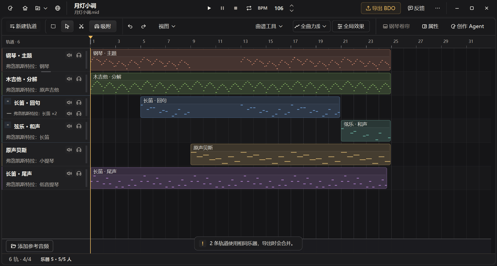
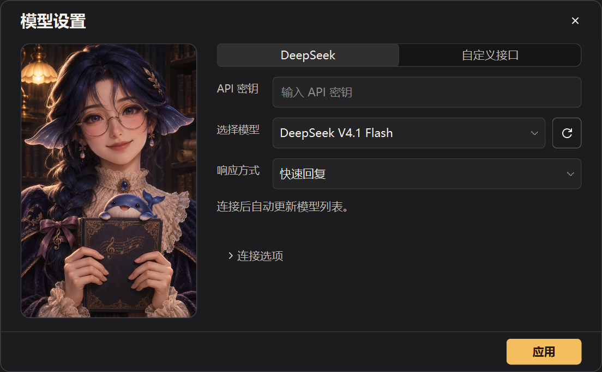

  

  <strong>《黑色沙漠》作曲玩家的 Windows 多轨编辑器</strong> 
  MIDI 导入 · Clip 编排 · 钢琴卷帘 · BDO v9 导出

  <a href="https://github.com/CocoaMist/BDO_Music_Composer/releases/latest"><strong>下载 Windows 版</strong></a> ·
  <a href="https://github.com/CocoaMist/BDO_Music_Composer/issues">报告问题</a> ·
  <a href="CHANGELOG.md#unreleased">源码更新</a>

  <a href="docs/locales/zh-CN.md">简体中文</a> ·
  <a href="docs/locales/en.md">English</a> ·
  <a href="docs/locales/ja.md">日本語</a> ·
  <a href="docs/locales/ko.md">한국어</a>

  <a href="#为什么做这个">为什么做这个</a> ·
  <a href="#写谱时能做什么">写谱时能做什么</a> ·
  <a href="#怎么开始">怎么开始</a> ·
  <a href="#源码与许可">源码与许可</a>

---

## 为什么做这个

我做这个工具，是想让玩《黑色沙漠》的朋友能在本地编曲、试听，再把曲谱带回游戏里一起演奏。手头有一份 MIDI 的时候，想试一下让长笛第二遍再进，或把伴奏那几颗音放轻一点，打开工程就能改。试听、保存和导出都用你改过的那份音符。

> 薄荷可可维护这个项目，ChatGPT 和 Codex 协助设计、写代码和跑测试。感谢 CN 服务器「彩虹乐队」的玩家把它拿去写歌，还把遇到的问题带回来。

---

## 写谱时能做什么

*界面取自源码版。示例乐段为截图专门生成，点图可以放大。*

- **先排段落** · 在时间轴上移动、切分、复制 Clip，单独调整某个片段、整轨或全曲的力度。
- **再修音符** · 双击 Clip 打开钢琴卷帘，改音高、时值、奏法和力度。可以边看编排边改音符，也可以把卷帘单独打开。
- **听一遍再导出** · 在本机试听，也能加载参考音频做对照。完成后导出 BDO v9，进游戏复核乐器和效果。

### 创作 Agent

卡在某句旋律时，可以选一段问它乐句怎么接，或者请它试写一段伴奏。源码版的模型设置可连接 DeepSeek 或 OpenAI 兼容接口，支持自动读取模型列表，也能手动填模型 ID。

使用联网模型时，这一轮的指令和所需曲谱信息会发送给你配置的服务。MIDI 编辑和本机试听可独立使用。

---

## 怎么开始

1. 在下载页取 Windows 版，双击 `BDO-Music-Composer.exe`。单文件版可以直接运行。
2. 导入 MIDI 或打开已有的 BDO 曲谱，选一段，先按播放听听。
3. 双击想改的 Clip。改完把工程也存一份，之后还能继续编辑 Clip 和轨道。
4. 导出时填写有效的 Owner ID，把曲谱带回游戏试听。

下载页列出已发布版本。上面的同屏工作区和模型设置展示的是仓库源码。[查看未发布改动](CHANGELOG.md#unreleased)

---

## 源码与许可

源码入口是 `main.py`，开发环境使用 Python 3.12。想改代码或从源码运行，可以先看[贡献指南](CONTRIBUTING.md)。维护者接手可从 [AGENTS.md](AGENTS.md) 和[接手手册](docs/AGENT_HANDOFF.md)开始。

[文档索引](docs/README.md) · [隐私与本机数据](docs/locales/zh-CN.md#隐私) · [第三方声明](THIRD_PARTY_NOTICES.md)

原创代码使用 [MIT](LICENSE)。这是独立社区项目，《黑色沙漠》及相关游戏素材的权利归各自权利方所有。
